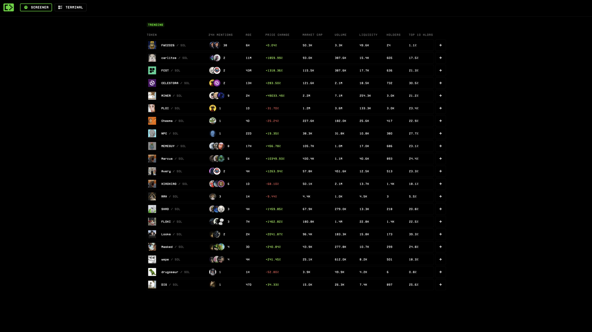

# CienceTerminal

Real-time crypto attention terminal: scans Twitter streams, classifies tweets
with LLM inference, extracts and verifies Solana contract addresses on-chain,
and pushes alerts to clients over SignalR — before price discovery catches up.

Built and run by one person in 2025.

Event-driven microservices on .NET 9 / AWS (SNS/SQS, ECS, RDS), React 19
frontend. Operated in production on AWS in 2025.



## Architecture

Four services, communicating **only** through SNS/SQS events — no inter-service
HTTP. Each follows Clean Architecture (Domain / Application / Infrastructure /
API) with CQRS via MediatR inside service boundaries.

| Service | Role |
|---|---|
| `services/api-gateway` | Single entry; Auth0 JWT validation, YARP routing |
| `services/twitter-scanner` | Stream ingestion, Groq classification, CA extraction, on-chain check |
| `services/alert-service` | SQS consumption, alert lifecycle, SignalR distribution |
| `services/token-metrics-service` | Token metadata & metrics from Jupiter, cache tiers; publishes back |
| `shared/` | Event contracts, SNS publisher, `SqsEventConsumer<TEvent>`, common |
| `frontend/` | React 19 + TypeScript SPA: SignalR, Auth0, kbar, demo mode |

One PostgreSQL database, three DbContexts over it. Token Metrics maps `coins`,
`mention_aggregates`, `ca_mention_records` and `alerts`; the scanner writes
`ca_mention_records`; the alert service writes `alerts` and reads the other
three through a read-only DbContext.

## Quick start

```bash
# Hybrid (recommended): LocalStack in Docker, services native, frontend hot-reload
./scripts/dev-start.sh

# Everything containerized
./scripts/dev-start.sh --docker

# Provision local SNS topics + SQS queues after LocalStack is up
./scripts/setup-aws-resources-docker.sh
```

Per-service configuration lives in service-local `.env` files — see the
`.env.example` in each service directory. No secrets are committed; keys (Groq,
Twitter, Helius, Auth0) are injected via environment. Frontend supports
`VITE_DEMO_MODE=true` to run with mock data, no backend or auth required.

## Documentation

- [CLAUDE.md](CLAUDE.md): services, data flow, DB schema, event topology
- [DEPLOYMENT_GUIDE.md](DEPLOYMENT_GUIDE.md): AWS production deployment
- [docs/api-architecture.md](docs/api-architecture.md): gateway routing,
  SignalR hub flow, CORS, versioning
- [services/token-metrics-service/ARCHITECTURE.md](services/token-metrics-service/ARCHITECTURE.md):
  cache tiers, external APIs
- [frontend/README.md](frontend/README.md): frontend setup and demo mode
- [Product docs (GitBook)](https://cienceterminal.gitbook.io/cienceterminal-docs/)

## Status

This repo is the December 2025 development state of the platform. The system ran
in production on AWS (ECS + SNS/SQS + RDS + Amplify) with live users; a later
production iteration with further work post-dates this snapshot. Test
projects are scaffolded in the solution layout but not implemented. The frontend
is mid-refactor to a styled-components design system.
